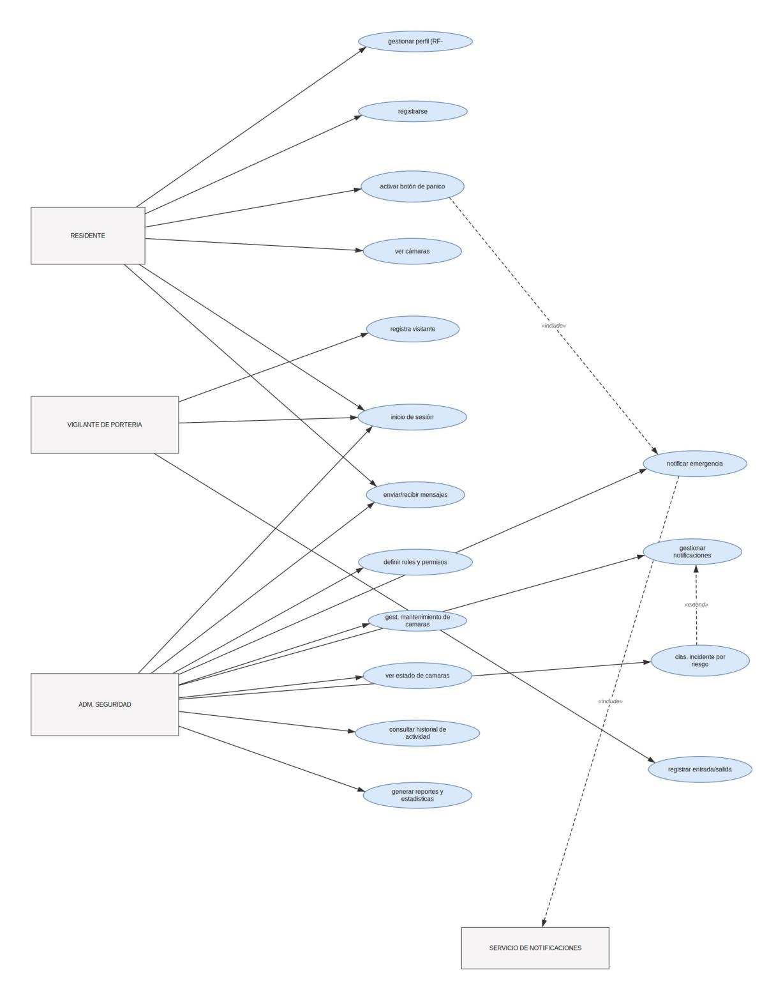
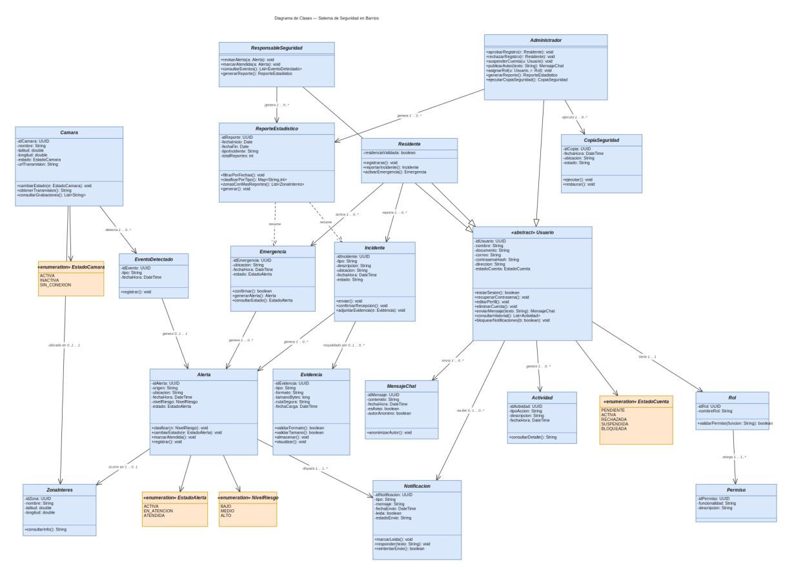
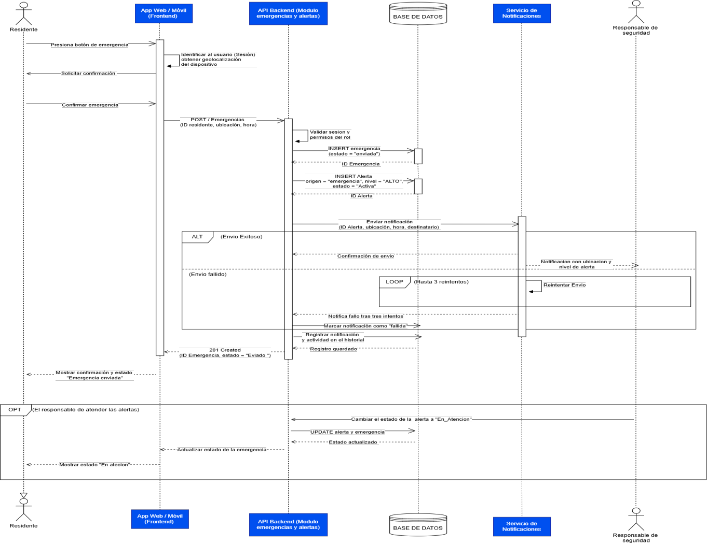
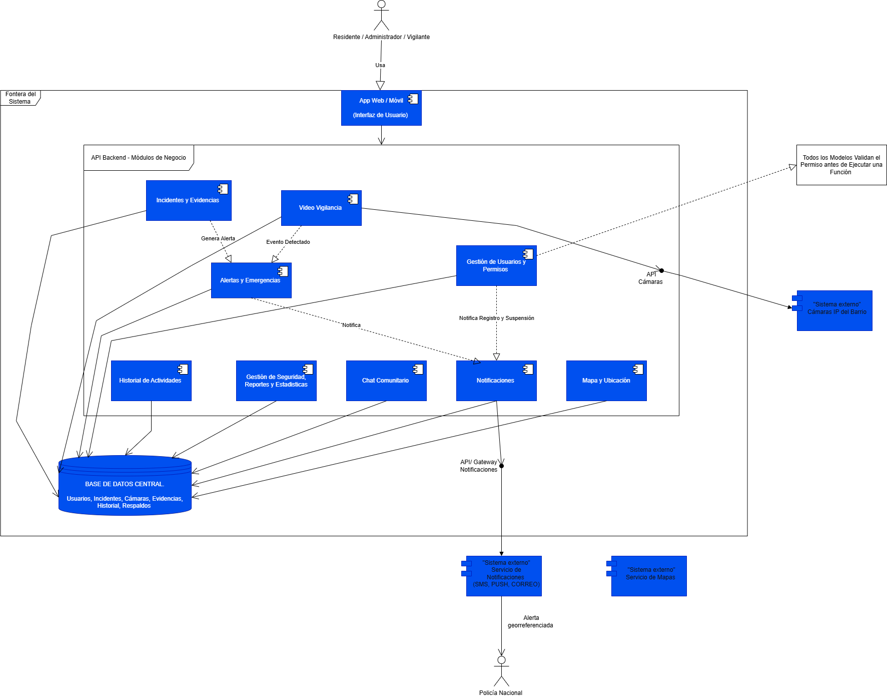
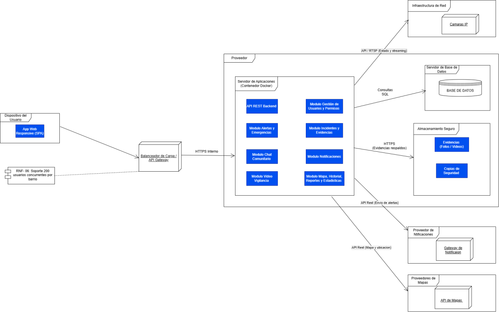
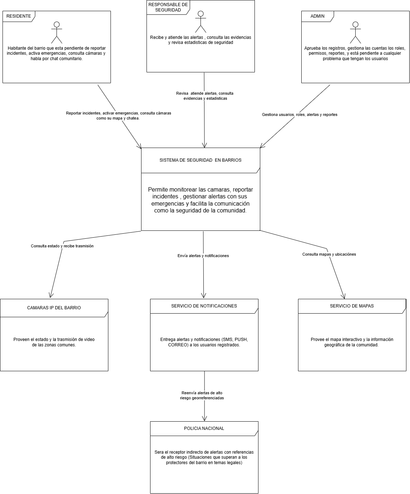
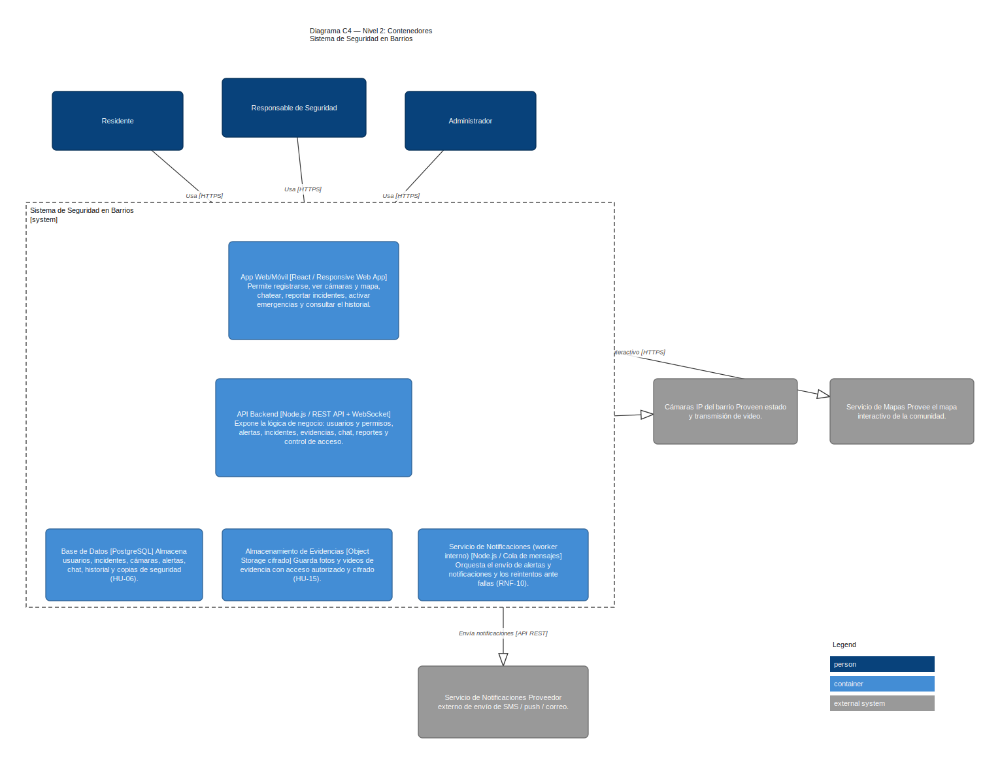
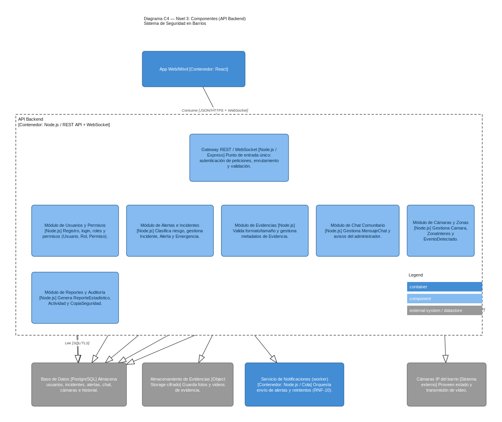

# 1. Modelos UML y C4 corregidos

Esta sección reúne los seis modelos del taller de la semana 10 (casos de uso, clases, secuencia, componentes, despliegue, C4 nivel 1 y C4 nivel 2) más el C4 nivel 3 de bonificación.

**Revisión cruzada.** El equipo que revisó nuestros modelos no reportó correcciones («el trabajo está muy bien»), por lo que los seis modelos se mantienen como en la Entrega 2. Las explicaciones detalladas de cómo leer cada diagrama están en esa entrega; aquí se presentan los modelos finales junto con las historias de usuario que cubren.

| Modelo | Pregunta que responde | Historias principales | Archivo fuente editable |
|---|---|---|---|
| Casos de uso | ¿Qué puede hacer cada actor? | HU-01, HU-02, HU-03, HU-09, HU-13 | Diagrama de casos de uso.drawio |
| Clases | ¿Qué conceptos y datos forman el dominio? | HU-06, HU-08, HU-14, HU-15 | Diagrama_Clases.drawio |
| Secuencia | ¿En qué orden se comunican las partes al activar una emergencia? | HU-05, HU-09, HU-14 | Diagrama de secuencia.drawio |
| Componentes | ¿Cómo se divide lógicamente el software? | HU-03 a HU-12 | Diagrama Componentes.drawio |
| Despliegue | ¿En qué infraestructura corre cada parte? | HU-06, HU-15 | Diagrama de Despligue.drawio |
| C4 nivel 1 (contexto) | ¿Quién usa el sistema y con qué sistemas externos se relaciona? | Todas | Diagrama C4 nivel 1 Contexto.drawio |
| C4 nivel 2 (contenedores) | ¿Qué unidades principales tiene el sistema? | HU-04, HU-05, HU-06, HU-15 | C4_Nivel2_Contenedores.drawio |
| C4 nivel 3 (componentes del API) | ¿Cómo se organiza por dentro el API Backend? (bonificación) | HU-01 a HU-15 | C4_Nivel3_Componentes.drawio |

## 1.1 Casos de uso

## 1.2 Clases

## 1.3 Secuencia: activar una emergencia

## 1.4 Componentes

## 1.5 Despliegue

## 1.6 C4 nivel 1: contexto

## 1.7 C4 nivel 2: contenedores

## 1.8 C4 nivel 3: componentes del API Backend (bonificación)

