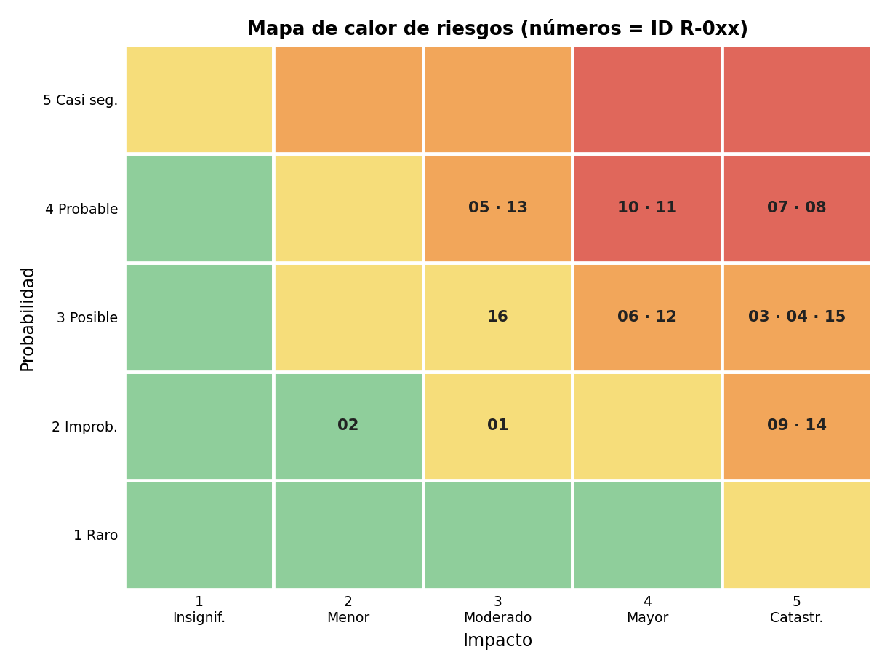

# 7. Matriz de riesgos actualizada

Partimos de la matriz de la semana 8 (probabilidad × impacto, escala de 1 a 5) y la revisamos con tres preguntas: ¿qué riesgos se cerraron?, ¿cuáles se materializaron? y ¿qué riesgos técnicos nuevos surgieron al construir? El archivo completo y editable es `Matriz_Riesgos_Actualizada.xlsx`.

**Correcciones a la matriz original:** el encabezado de impacto decía «1-3» aunque la escala y los datos usan 1-5, y la validación de la celda no permitía el 4 ni el 5. Se normalizaron los estados a los valores de la lista del archivo (Abierto, Monitoreando, Cerrado, Materializado) y se completó la fila R-009, que estaba incompleta.

## 7.1 Registro de riesgos

| ID | Riesgo | P | I | P×I | Nivel | Estado | Revisión semana 13 |
|---|---|---|---|---|---|---|---|
| R-001 | Retraso en la entrega de un componente crítico | 2 | 3 | 6 | Medio | Cerrado | Cerrado (propuesto) |
| R-002 | Cambio frecuente de requerimientos | 2 | 2 | 4 | Bajo | Materializado | Materializado |
| R-003 | Indisponibilidad de recurso clave | 3 | 5 | 15 | Alto | Monitoreando | Sigue vigente |
| R-004 | El estado nos impide poner camaras | 3 | 5 | 15 | Alto | Monitoreando | Sigue vigente |
| R-005 | Fallas de conexión  | 4 | 3 | 12 | Alto | Abierto | Sigue vigente |
| R-006 | Capacidad de usuarios  | 3 | 4 | 12 | Alto | Abierto | Sigue vigente |
| R-007 | Vandalismo dentro del sistema  | 4 | 5 | 20 | Crítico | Monitoreando | Sigue vigente |
| R-008 | Alcance de ingresos no esperados | 4 | 5 | 20 | Crítico | Monitoreando | Sigue vigente |
| R-009 | Caída de la base de datos | 2 | 5 | 10 | Alto | Abierto | Nuevo (completado) |
| R-010 | Inyección de código (XSS) por mostrar texto del usuario como HTML | 4 | 4 | 16 | Crítico | Materializado | Nuevo técnico (corregido) |
| R-011 | Autorización solo en el cliente (control de roles saltable) | 4 | 4 | 16 | Crítico | Abierto | Nuevo técnico |
| R-012 | Notificación de emergencia tarda más de 5 s en entorno real (RNF-02) | 3 | 4 | 12 | Alto | Abierto | Nuevo técnico |
| R-013 | Defectos no detectados por falta de pruebas automáticas | 4 | 3 | 12 | Alto | Materializado | Nuevo técnico (mitigado) |
| R-014 | Evidencia alterada o perdida (cadena de custodia, HU-15) | 2 | 5 | 10 | Alto | Monitoreando | Nuevo técnico |
| R-015 | Incumplimiento de la protección de datos personales (Ley 1581 de 2012) | 3 | 5 | 15 | Alto | Abierto | Nuevo |
| R-016 | Dependencia de servicios externos (fuentes CDN, mapas, SMS) | 3 | 3 | 9 | Medio | Abierto | Nuevo técnico |

## 7.2 Resultado de la revisión

- **Riesgos cerrados:** R-001 (retraso por proveedor externo): el prototipo no depende de proveedores y se entregó a tiempo. Se reabrirá al integrar servicios reales.
- **Riesgos materializados:** R-002 (cambio de requerimientos: se agregó HU-15 y cambió el rol de seguridad), R-010 (inyección de código en el chat, corregida), R-013 (defectos por falta de pruebas: se encontraron dos al probar).
- **Nuevos riesgos técnicos surgidos de la construcción:** R-010 a R-016 (inyección de código, autorización solo en el cliente, latencia de notificaciones, falta de pruebas, integridad de evidencias, datos personales y dependencias externas), más R-009 (caída de la base de datos), que se completó.
- **Riesgos que siguen abiertos o en monitoreo:** R-003 a R-008, R-009, R-011, R-012, R-014, R-015 y R-016.

**Cómo leer el mapa.** Cada número es un riesgo (por ejemplo, 07 es R-007) ubicado según su probabilidad y su impacto. Rojo = crítico (16 a 25), naranja = alto (10 a 15), amarillo = medio (5 a 9) y verde = bajo (1 a 4). Los riesgos críticos son R-007, R-008, R-010 y R-011.
